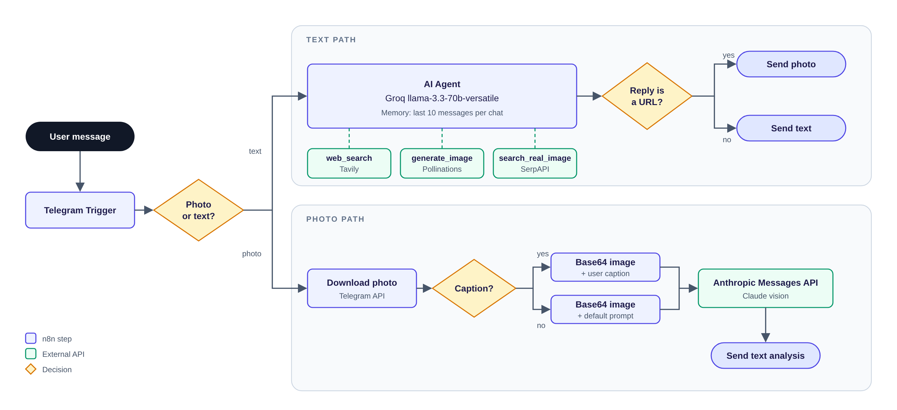

# n8n Telegram Bot


A multi-modal Telegram assistant built entirely as a single [n8n](https://n8n.io) workflow. It chats in text, searches the web for current information, generates AI images, finds real photos, and understands photos you send it through the Anthropic API.

## Features

- **Conversational chat** with short-term memory (the last 10 messages of each chat).
- **Live web search** for news, dates, scores and anything that changes, so answers are not guessed.
- **AI image generation** from a text description.
- **Real image search**: returns an actual photo of a person, place or object instead of a generated one.
- **Photo understanding**: send a photo, with or without a caption, and get an analysis or the text read from it.
- **No server code**: the whole bot is one importable `workflow.json`.

## Architecture



Every message enters through the Telegram Trigger and is routed by type:

| Message | Path | Result |
| --- | --- | --- |
| Text | AI Agent (Groq) with three tools | A text reply, or a photo when the agent returns an image URL |
| Photo | Photo is downloaded, converted to Base64, sent to the Anthropic Messages API | A text analysis of the image |
| Photo with caption | Same as photo, with the caption included in the prompt | An answer that considers both image and caption |

### Agent tools

| Tool | Provider | Use |
| --- | --- | --- |
| `web_search` | [Tavily](https://tavily.com) | Current events, dates, scores, news (top 3 results) |
| `generate_image` | [Pollinations](https://pollinations.ai) | AI-generated or illustrated images (no key needed) |
| `search_real_image` | [SerpAPI](https://serpapi.com) Google Images | Real photos (top 5 results) |

The agent's system prompt tells it when to use each tool and to answer image requests with only the image URL, which the workflow then sends as a Telegram photo.

## Tech stack

| Layer | Technology |
| --- | --- |
| Orchestration | n8n |
| Chat model | Groq, `llama-3.3-70b-versatile` |
| Vision model | Anthropic Messages API (Claude) |
| Search | Tavily, SerpAPI |
| Image generation | Pollinations |
| Interface | Telegram Bot API |

## Getting started

### Prerequisites

- An n8n instance (cloud or self-hosted) with the AI nodes available.
- A Telegram bot token from [@BotFather](https://t.me/BotFather).
- API keys for [Groq](https://console.groq.com), [Anthropic](https://console.anthropic.com), [Tavily](https://tavily.com) and [SerpAPI](https://serpapi.com).

### Installation

1. In n8n, choose **Workflows > Import from file** and select `workflow.json`.
2. Create credentials for **Telegram** (bot token) and **Groq**, then assign them to the Telegram and Groq nodes. Imported credential IDs are set to `REPLACE_ME`.
3. Replace the placeholders below with your own keys.
4. Activate the workflow. A Telegram Trigger needs a publicly reachable HTTPS webhook URL, so set `WEBHOOK_URL` when self-hosting.
5. Message your bot.

### Configuration

| Placeholder | Node | Where it goes |
| --- | --- | --- |
| `YOUR_ANTHROPIC_API_KEY` | `HTTP Request`, `HTTP Request1` | `x-api-key` header |
| `YOUR_TAVILY_API_KEY` | `web_search` | `api_key` field of the JSON body |
| `YOUR_SERPAPI_API_KEY` | `search_real_image` | `api_key` query parameter |

> Use n8n credentials or environment variables instead of pasting keys into nodes, and never commit a workflow that contains real keys.

## Usage examples

| You send | The bot does |
| --- | --- |
| `Who won the match last night?` | Searches the web, then answers from the results |
| `Draw a lighthouse at sunset, watercolor style` | Generates an image and sends it as a photo |
| `Show me a real photo of the Eiffel Tower` | Finds a real image URL and sends it as a photo |
| A photo of a document | Describes the image and reads the text in it |
| A photo with the caption `Is this plant safe for cats?` | Analyses the image with your question in mind |

## Project structure

```
n8n-telegram-bot/
├── workflow.json          # Importable n8n workflow (secrets removed)
├── docs/
│   └── architecture.png   # Diagram used in this README
├── CLAUDE.md              # Project notes for Claude Code
└── README.md
```

## Known limitations

- Image detection treats any agent reply containing `http` as a photo, so a text answer that includes a link is sent as a photo and can fail.
- Chat memory is held in n8n's memory and is cleared when n8n restarts.
- Photo analysis does not use chat memory, so follow-up questions about a photo are not remembered.
- The Anthropic reply is read from the second content block of the response, which may need adjusting for other models.
- Only the `message` update type is handled. Edited messages, voice notes and documents are ignored.

## Roadmap

- Move all API keys into n8n credentials.
- Detect image URLs by file type instead of searching for `http`.
- Store chat memory in a database so it survives restarts.
- Add voice-note transcription and document support.

## Author

**Mohammed** ([@mohammed-m-bakroon](https://github.com/mohammed-m-bakroon)), backend developer specializing in Laravel and AI workflow automation with n8n.
